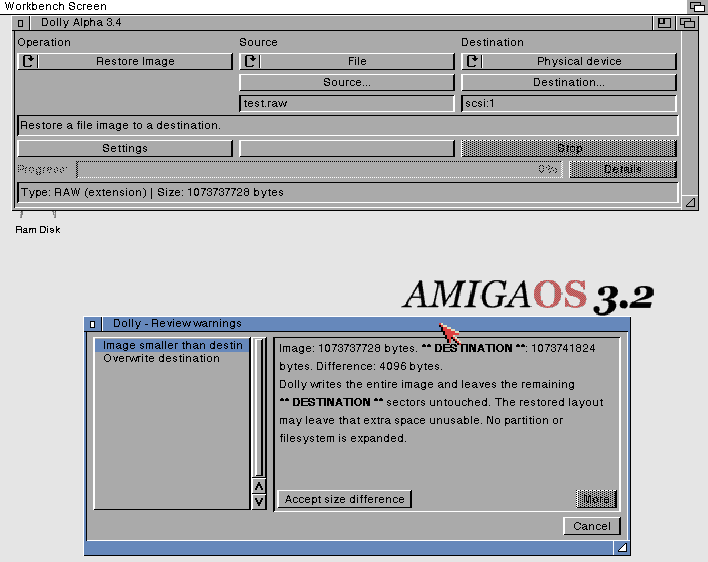
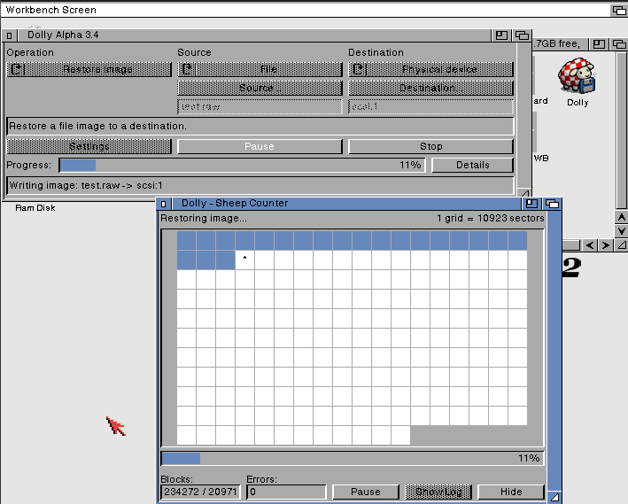

# 🐑 Dolly — Disk Imaging, Cloning & Recovery for Amiga

Dolly is a disk imaging, cloning and diagnostics utility for classic Amiga computers. The native interface uses Intuition and GadTools and targets MC68000 and AmigaOS 2.04 or later.

[Download Dolly Alpha 3.8 for MC68000](https://github.com/tomaszkmarcinkowski-alt/dolly-amiga/releases/tag/v0.1.0-alpha.3.8) · [Revision history](docs/REVISION_HISTORY.md) · [All releases](https://github.com/tomaszkmarcinkowski-alt/dolly-amiga/releases)


*Sector copy in an earlier Alpha 3 build.*



*Dolly on AmigaOS 3.2 with a scalable font and square pixels. The main window and Warning Review adapt to the font. The selected warning explains what happens when the image is smaller than the destination.*



*Restore Image in progress on AmigaOS 3.2. The main window shows the overall progress, and Sheep Counter shows the sector grid, block counts and errors.*

## What works in Alpha 3.8

| Feature | Current scope |
| --- | --- |
| Sheep Inventory | Inspect device geometry and RDB/MBR partitions, copy details to the clipboard, export partition-table backups and restore RDB on supported offline targets. |
| Surface Scan | Read-only scan of a selected sector range with retries, LBA/CHS reporting and an exportable log. |
| Create Image | Write staged RAW, HDF or IFF DOLY images, with split output available in IFF DOLY. Resume single-file images from a verified DLRP checkpoint through **Project → Resume operation...**. DOLY offers raw, Fast (PackBits) and Compact (LZSS/PackBits) modes. |
| Restore Image | Write RAW/HDF or single-file and split IFF DOLY images to a whole device or in-range RDB partition. Size differences and layout discrepancies require explicit confirmation. **Resume operation...** also accepts Restore and sector-copy checkpoints. |
| Sector-to-sector Copy | Copy equally sized whole devices or in-range RDB partitions, with optional read-back verification. |
| Smart Copy | Copy allocated OFS/FFS blocks between compatible RDB partitions, including mixed Partition and Logical device selections. |
| Clone and resize | Prototype for cloning DOS/1 and DOS/3 between differently sized RDB partitions with 512-byte blocks. Unsupported layouts can be analyzed where possible. |
| ShapeShifter | Import a Macintosh FileDisk into a dedicated RDB partition with an APM and a user-supplied driver template. Export a whole virtual disk or one eligible HFS-family volume as a single RAW file. [ShapeShifter guide](docs/SHAPESHIFTER_HFS_RESEARCH.md). |
| Sheep Counter | Open the resizable Details window during an operation for the sector grid, block and error counts, and the log when available. Its progress bar shows the elapsed time and live transfer rate when space permits. |

Dolly reviews warnings before raw transfers and checks related AmigaDOS
filesystems. It attempts to inhibit raw sources and take filesystems in the
destination range offline. Operation summaries report processed data and timing.
Use disposable media for alpha write tests. See [device writes](docs/DEVICE_WRITE.md)
for size mismatch consequences and [the test matrix](docs/TEST_MATRIX.md)
for the boundary between host tests, cross-builds and native runtime evidence.

The desktop resize tool produced verified DOS/3 images at 95 MiB and 400 MiB.
FS-UAE also verified a native DOS/3 resize with bitmap relocation and checked
that writes left the source and destination RDB intact.

Smart Copy on AmigaOS 3.2 was verified in WinUAE by booting from the
destination and mounting the renamed volume after reboot with RDB mode enabled.

## Getting started

Download the MC68000 executable from the release page, copy it to your Amiga,
and run it on AmigaOS.
Use the operation, source and destination selectors in the main window.
Settings holds font, I/O and destination mounting options. See [installation](docs/INSTALLATION.md)
and [AmigaOS I/O](docs/AMIGA_IO.md) for runtime details.

Build and test the portable tools on a host:

```sh
cmake -S . -B build
cmake --build build
ctest --test-dir build --output-on-failure
```

See [native build instructions](docs/NATIVE_SMOKE.md) for the MC68000 toolchain.

## Documentation

- [Operation workflows, step by step](docs/OPERATIONS_EN.md)
- [User and developer documentation](docs/README.md)
- [Roadmap](docs/ROADMAP.md), [backlog](docs/BACKLOG.md) and [GitHub Issues](https://github.com/tomaszkmarcinkowski-alt/dolly-amiga/issues)
- [Contributing](CONTRIBUTING.md) and [MIT License](LICENSE)

## Goals

- Support classic AmigaOS on baseline MC68000 without an FPU or MMU.
- Fully resolution, font size and aspect ratio aware GUI with resizable windows.
- Extend image and recovery support with resumable transfers,
  filesystem-aware copying and resizing, and controlled Disk Vet repair.
