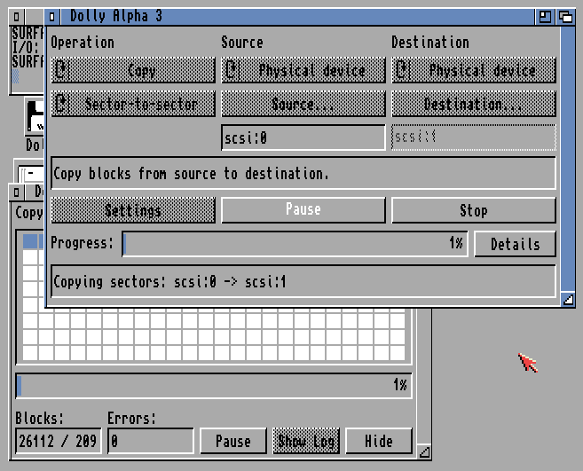

# 🐑 Dolly — Disk Imaging, Cloning & Recovery for Amiga
[Dolly Alpha 3](docs/RELEASE_ALPHA_3.md) · [GitHub Releases](https://github.com/tomaszkmarcinkowski-alt/dolly-amiga/releases)
[Restore RDB test build](docs/RELEASE_RDB_TEST.md) · [Warning review test for MC68000](https://github.com/tomaszkmarcinkowski-alt/dolly-amiga/releases/tag/warning-review-test-20261119) · [Main-window test build for MC68000](https://github.com/tomaszkmarcinkowski-alt/dolly-amiga/releases/tag/main-window-test-20261119)

**Public development repository • Alpha 3 development preview • experimental native prototypes**

**No sector left behind. No sheep uncounted.**

Dolly is a free, community-developed disk imaging, disk cloning, backup/restore and filesystem recovery project for classic Commodore Amiga computers.

## Screenshot



Sector-by-sector copying in an Alpha 3 development build. [Download the test build](https://github.com/tomaszkmarcinkowski-alt/dolly-amiga/releases/tag/warning-review-test-20261119)

## Goals
- AmigaOS 2.04+, Motorola 68000 baseline, no FPU or MMU required.
- CLI plus **built-in GadTools GUI** in the MVP; optional ReAction and MUI backends are **post-MVP**, separately delivered extensions.
- Read/write ADF, HDF, RAW; IFF `FORM DOLY` image container with segmented/compressed data.
- RDB, nested/hybrid MBR/RDB, PiStorm/Emu68 layouts and later GPT.
- RAW cloning and filesystem-aware resizing for OFS/FFS (`DOS\0`–`DOS\7`).
- Read-only DiskDoctor analysis followed by controlled recovery/repair.
- Disk-based scratch, optional AddBuffers with consent and rollback, safe/experimental Berserk modes.
- Dedicated **Sheep Counter** 320×256 progress screen with error counters, sheep mascot and optional 8-bit audio.

## Current implementation

| Area | Availability |
| --- | --- |
| M0 foundations | Read-only BlockSource, host image inspection, bounded RDB/MBR parsing, hybrid and capacity diagnostics, structural IFF inspection, device-profile safety checks. |
| Native GadTools | Compact main window with in-frame progress, Source/Destination pickers, Sheep Inventory and resizable Sheep Counter. Settings offers an ASL font selector. Start opens a shared warning review when needed. |
| Surface Scan | Read-only scans using validated RDB settings and per-unit I/O overrides, selectable LBA/CHS ranges and retries, progress, error map and text logs with LBA and CHS when reported geometry permits. |
| Create Image | Whole unit, partition or logical volume to RAW, HDF or IFF DOLY. Staged output and DLRP checkpoints after supported unexpected failures. |
| Restore and Copy/Clone | Sector-to-sector Copy and flat RAW/HDF Restore use bounded writes to eligible offline targets. Smart Clone, resizing and IFF DOLY Restore remain in development. |
| IFF DOLY | Single-file v1 raw and v2 Fast (PackBits) or Compact (LZSS/PackBits) with per-chunk CRC32. |

MC68000 builds and FS-UAE A600 / AmigaOS 2.05 checks have passed for the
prototypes. See the [test matrix](docs/TEST_MATRIX.md) for exact coverage.
Native runtime qualification of the new write paths, Smart Clone and repair
remain open.

```sh
cmake -S . -B build
cmake --build build
ctest --test-dir build --output-on-failure

./build/dolly-inspect image.adf
./build/dolly-rdb drive.hdf 0 512
./build/dolly-layout pistorm.img 512
./build/dolly-iff backup.dly
```

See [Surface Scan](docs/SURFACE_SCAN.md), [Create Image](docs/CREATE_IMAGE.md),
[IFF DOLY](docs/IFF_FORMAT.md), [DLRP checkpoints](docs/DLRP_FORMAT.md),
[Restore development](docs/DEVICE_WRITE.md) and [AmigaOS I/O limits](docs/AMIGA_IO.md).

## Plans and community
See [project scope](docs/SPECIFICATION.md), the [product backlog](docs/BACKLOG.md), [M0 sprint](docs/SPRINT_M0.md), [roadmap](docs/ROADMAP.md), [Polish introduction article](docs/ARTICLE_PL.md), [Retroware](RETROWARE.md), [contributing](CONTRIBUTING.md) and the [Post-MVP Flock Manager epic](https://github.com/tomaszkmarcinkowski-alt/dolly-amiga/issues/7).

## Engineering journal

Read the chronological [Engineering Field Notes](docs/ENGINEERING_JOURNAL.md) for confirmed bugs, open hypotheses, fixes, regressions, hardware quirks and project easter eggs.

## RDB collision and hybrid diagnostics

The experimental host utilities also detect collisions between RDB partitions, `RDSK` and `PART` metadata. `dolly-layout` reports when MBR and a whole-device RDB are both present; neither view is automatically assumed safe for writes. This is preliminary inspection, not full hybrid-drive support. See [Issue #12](https://github.com/tomaszkmarcinkowski-alt/dolly-amiga/issues/12).

## Guided DMA troubleshooting (prototype)

Dolly's DMA diagnostic catalog now includes a cause and up to three **safe, actionable checks** for each recognized DMA problem, rather than only a generic error. Try `dolly-dma-advice DMA_ADDRESS_MASK pl` (PL ASCII fallback) or `dolly-dma-advice DMA_ALIGNMENT en` on a host; the portable helper is also included in the native-only cross-build targets. These instructions never change the controller configuration and are not a substitute for testing on AmigaOS. See [DMA safety and troubleshooting](docs/DMA_SAFETY.md).

## DMA safety policy (experimental)

The native read path uses validated RDB I/O settings by default and supports a per-unit manual override. The host mock exercises DMA address constraints, NSD capability handling, short reads and I/O errors. Physical controller validation is pending. See [Amiga I/O policy](docs/AMIGA_IO.md#automatic-settings-and-manual-override).

## Motorola 68000 smoke milestone

An experimental, POSIX-free `dolly-native-smoke` target now exercises synthetic RDB parsing and read planning **in memory**; it cannot access disks. The early cross-build and WinUAE smoke run were reported by the maintainer. Later emulated tests are recorded separately. See [Native smoke test and cross-build instructions](docs/NATIVE_SMOKE.md).

## Sheep Inventory

The preliminary `dolly-inventory IMAGE [BLOCK_BYTES]` command displays MBR/RDB partition details using a **streaming, allocation-free field API** with units, provenance, evidence levels (declared/observed/derived/estimated) and explicit unavailable values. The early field providers cover RDSK, PART (including signed Boot Priority) and MBR; device and filesystem support are planned. Shared non-destructive warning streams cover MaxTransfer and preliminary RDB overlap checks, **including contextual, safe suggested checks**. The native GadTools prototype shows device and partition details, supports clipboard copying and exports supported RDB/MBR metadata backups. See [Sheep Inventory design](docs/SHEEP_INVENTORY.md) and [Issue #13](https://github.com/tomaszkmarcinkowski-alt/dolly-amiga/issues/13).

## MaxTransfer audit

Dolly's experimental read-only RDB tools now report per-partition `de_MaxTransfer` values and flag settings above conservative `0x1FE00`. See [MaxTransfer diagnostics](docs/MAXTRANSFER.md); no setting is changed automatically.

## Installation convention: DOLLY:

The main Amiga installation root uses `DOLLY:` for program files and resources, independent of the user's current directory. The classic Installer package is planned (Issue #16); the M0 C99 path resolver and its tests are already in the repository. The installer will ask before adding a persistent `S:User-startup` assignment. See [installation specification](docs/INSTALLATION.md).

## Licensing
Dolly source code is licensed under the **[MIT License](LICENSE)**. Software will remain free of mandatory fees. Gifts of retro-computing hardware are wholly voluntary and confer no entitlement.

**Please do not use M0 software on valuable media; it is an incomplete prototype.**

## Low-resolution GUI and live screen changes (design stage)

Dolly's native baseline is **640×256 with topaz.font/8**, including window borders, title and buttons. Default UI text follows the current **system Screen Font**; an explicitly selected custom Dolly font takes precedence *only if it fits*. Otherwise views reflow using Screen Font, then Topaz/8 and compact pagination. If even the compact layout cannot fit, no inaccessible window should open.

The portable screen watcher coalesces screen mode/font change events. On AmigaOS 2.x+ the experimental `StartNotify` adapter watches `ENV:sys/screenmode.prefs` and `screenfont.prefs`. A future optional `screennotify.library` adapter will handle additional public-screen lifecycle notifications. Live screen-mode notification remains prototype work beside the tested GadTools windows. See [GUI architecture](docs/GUI_ARCHITECTURE.md), [Issue #14](https://github.com/tomaszkmarcinkowski-alt/dolly-amiga/issues/14) and [Issue #15](https://github.com/tomaszkmarcinkowski-alt/dolly-amiga/issues/15).

## Optional-resource compatibility and controller knowledge

Every optional `DOLLY:` asset must match the **exact running Dolly release** and its own format/API version and pass file-integrity checks. Missing, unreadable, unversioned or incompatible add-ons are disabled with a specific path, consequence and suggested remedy; GadTools and the built-in core remain usable. The pure C99 decision layer is implemented, but native AmigaDOS file verification/startup UI remain future work.

The planned controller knowledge base under `DOLLY:Plugins/Devices/` can give **source-backed, device-specific DMA troubleshooting** instead of guesses. A unique device match plus verified database may supply documented warnings, never unconditional DMA authorization. See [installation policy](docs/INSTALLATION.md) and [DMA safety](docs/DMA_SAFETY.md).

## Integrity and configuration (M0 groundwork)

We use **exact Dolly release/build identity + CRC32** for the main executable and all optional assets; the per-resource format/API is checked for plugins. The **main executable embeds its own CRC32 and build ID**, alongside the standard AmigaDOS `$VER:` identifier. The post-link stamping tool and a C99 streaming checksum implementation are available. These detect **accidental** corruption, not malicious tampering. The C99 in-process executable CRC32 check is implemented as a portable module; integration into Dolly's **actual AmigaOS startup**, plus native file probing, remains open — see [integrity policy](docs/INTEGRITY.md).

A compatible controller database can prepare a user-approved proposal to **reduce** Dolly's local transfer size, but it cannot modify RDB, AmigaDOS settings or automatically authorize DMA. The optional [Dolly Rescue floppy](docs/RESCUE_FLOPPY.md) remains a future post-M0 deliverable.

## M0: RAW image / RDB capacity mismatch detection

Dolly now has a **read-only capacity audit** for an RDB placed on a medium or within an MBR 0x76 container of different size. It warns when RDB geometry describes more capacity than is observed, when a PART or metadata block exceeds the containing region, or when the observed region is larger than the RDB geometry. An extra tail is **not certified unallocated or safe for writing**. Host RDB/layout/Sheep Inventory CLI paths emit the notices.

Synthetic standalone capacity tests passed locally with GCC, Clang and ASan/UBSan, including 4/8/12 GiB arithmetic; the complete current GitHub build and real AmigaOS device-size discovery are still unverified. See [DOL-074](https://github.com/tomaszkmarcinkowski-alt/dolly-amiga/issues/23) and [M0 sprint](docs/SPRINT_M0.md).
